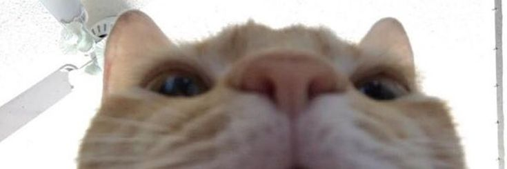
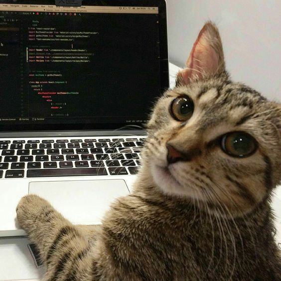

# Gunther Lee Ordinario

**Information Technology student · Web Developer**

*"Honor resides in precision, discipline, and constant growth. Every line of code is written with purpose."*

---

## About me

Hello, I'm Gunther. I'm an Information Technology student from Pangasinan, Philippines, driven to craft efficient and visually striking web solutions. I combine technical discipline with sharp frontend execution, and I enjoy working on clean code, seamless user experience and solid backend logic.

- 🎓 Studying **BS Information Technology** at the University of Eastern Pangasinan
- 🔭 Focused on **web development, databases and UI design**
- 🌐 My portfolio: **[devglee.vercel.app](https://devglee.vercel.app/)**
- 💼 Open for work and collaboration

 

---

## Tech stack

**Frontend**

**Backend and database**

**Design and tools**

 

---

## Featured projects

| Project | Description | Stack | Status |
| --- | --- | --- | --- |
| **[Glee Portfolio Website](https://devglee.vercel.app/)** | Interactive portfolio with a Ghost of Tsushima theme, responsive design, light and dark modes, custom modals and dynamic components. | HTML5, CSS3, JavaScript | Live |

## Get in touch

Got a project, an internship or a team opportunity? My inbox is open.

- 📧 [guntherlee17@gmail.com](mailto:guntherlee17@gmail.com)
- 🌐 [devglee.vercel.app](https://devglee.vercel.app/)
- 📘 [facebook.com/glee.ordinario](https://www.facebook.com/glee.ordinario)

<!--
OPTIONAL: GitHub stats card. Remove the comment markers around it to show it.
These cards come from a free third-party service and can occasionally be slow or unavailable.

-->

*Good things take time.*

⭐ Thanks for stopping by.

